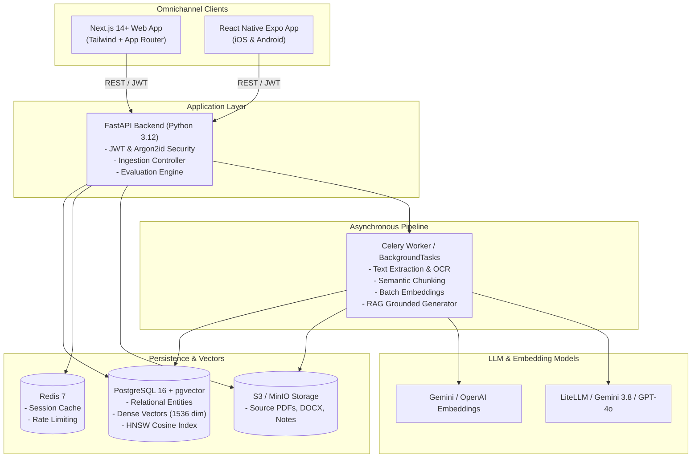
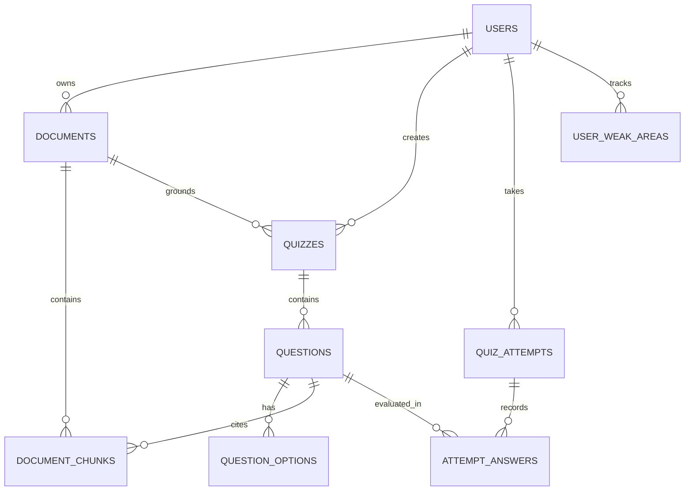

# 🚀 Quiz-Master-AI: Enterprise AI-First Educational Assessment Platform

[](https://www.python.org/)
[](https://fastapi.tiangolo.com/)
[](https://github.com/pgvector/pgvector)
[](https://nextjs.org/)
[](https://expo.dev/)
[](https://opensource.org/licenses/MIT)

**Quiz-Master-AI** is an enterprise-grade, AI-first educational assessment and personalized learning platform. By coupling **Retrieval-Augmented Generation (RAG)**, dense vector embeddings with **pgvector**, and structured LLM evaluation agents, Quiz-Master-AI automates the entire educational assessment lifecycle: from document ingestion and grounded question authoring to tamper-proof timed examinations, deterministic/rubric grading, and targeted conceptual weakness remediation.

---

## 📌 Key Architectural Pillars

1. **Automated Document Ingestion & Vector Indexing**:
   - Sanitize, parse, and recursively chunk educational materials (PDF, DOCX, TXT) with semantic 100-token overlap.
   - Vectorize chunks using high-dimensional dense embeddings (`text-embedding-3-small` / Gemini `text-embedding-004`) indexed with HNSW in PostgreSQL 16.
2. **Hallucination-Free RAG Quiz Generation**:
   - Strictly source-grounded question generation with Pydantic & Instructor structured schema enforcement.
   - Every generated question contains a verbatim quotation and page citation from the source material.
3. **Zero Client-Side Trust Exam Portal**:
   - The test-taking client **never receives correct options, explanations, or secret rubrics** before submission.
   - Client-side exam runtime features auto-save to `localStorage` / `AsyncStorage` and a **Visual Question Palette** (⚪ Not Visited, 🔵 Current, 🟢 Answered, 🔴 Not Answered, 🟣 Review).
4. **Server-Side Dual Evaluation Engine**:
   - Deterministic grading for objective questions (MCQs, Multi-Select, True/False).
   - Structured multi-criteria rubric evaluation with feedback and missing key-points for subjective short answers.
5. **Diagnostic Weakness Heatmap & 1-Click Adaptive Remediation**:
   - Tracks persistent errors by subject and topic in `user_weak_areas`.
   - Generates targeted adaptive practice sets to remediate conceptual blind spots.
6. **Omnichannel Experience**:
   - **Modern Web App**: Next.js 14+ App Router, Tailwind CSS, Lucide React, and Zustand.
   - **Mobile App**: Cross-platform React Native + Expo (iOS & Android).

---

## 🏗️ System Architecture & Data Flow



---

## 📂 Monorepo Organization

```text
quiz-master-ai/
├── apps/
│   ├── web/                    # Next.js 14+ App Router Web Application
│   │   ├── src/
│   │   │   ├── app/            # App routes (/login, /register, /dashboard, /documents, /quiz/create, /quiz/[id]/take, /quiz/[id]/results, /analytics)
│   │   │   ├── components/     # Visual Question Palette, TimerBanner, CitationCard, Navbar
│   │   │   ├── lib/            # Typed ApiClient with auto Bearer token injection
│   │   │   ├── store/          # Zustand stores (useAuthStore, useExamStore)
│   │   │   └── styles/         # Tailwind CSS, glassmorphism design tokens & typography
│   │   ├── package.json
│   │   └── tailwind.config.ts
│   │
│   └── mobile/                 # React Native Expo Mobile Client
│       ├── src/
│       │   ├── screens/        # LoginScreen, RegisterScreen, DashboardScreen, ExamScreen, ResultsScreen, DocumentsScreen
│       │   ├── components/     # MobilePalette, QuestionNavigator
│       │   ├── navigation/     # React Navigation 6 Native Stack
│       │   └── services/       # MobileApiClient
│       ├── app.json
│       └── package.json
│
├── services/
│   ├── api/                    # FastAPI Backend Service (Python 3.12)
│   │   ├── app/
│   │   │   ├── api/v1/         # Route controllers (/auth, /documents, /quizzes, /attempts, /analytics)
│   │   │   ├── core/           # Config (pydantic-settings), database session, security (Argon2id + JWT)
│   │   │   ├── models/         # SQLAlchemy 2.0 Async models with FlexibleVector (pgvector & SQLite support)
│   │   │   ├── schemas/        # Pydantic v2 validation contracts & Instructor schemas
│   │   │   ├── services/       # RAG pipeline, TextExtractor, Chunker, Embeddings, LLM, Evaluation, Analytics
│   │   │   └── main.py         # FastAPI application entrypoint
│   │   ├── tests/              # Pytest test suite (100% passing)
│   │   ├── Dockerfile
│   │   └── requirements.txt
│   │
│   └── worker/                 # Celery Asynchronous Processing Service
│       ├── tasks/              # parser.py, chunker.py, embedder.py, generator.py, evaluator.py
│       ├── celery_app.py
│       ├── Dockerfile
│       └── requirements.txt
│
├── packages/
│   └── shared-types/           # Shared TypeScript contracts and interfaces
│
├── docker-compose.yml          # Local infra (Postgres+pgvector, Redis, MinIO, API, Worker)
├── docker-compose.override.yml # Local development port mappings
├── .env.example                # Canonical environment variable specifications
└── README.md
```

---

## 🗄️ Database Entity-Relationship Diagram



---

## 🚀 Quickstart Guide

### 1. Prerequisites
- Docker & Docker Compose
- Node.js v18+ & npm
- Python 3.12+

### 2. Environment Setup
Copy the canonical configuration:
```bash
cp .env.example .env
```

### 3. Spin Up Infrastructure with Docker
```bash
docker compose up -d postgres redis minio
```
> **Non-conflicting Ports**:
> - PostgreSQL 16 + pgvector: `localhost:5435`
> - Redis 7: `localhost:6382`
> - MinIO Object Storage: `localhost:9002` (API) / `localhost:9003` (Console)

### 4. Build Shared Types & Run Database Migrations
```bash
# Build shared TypeScript package
npm --prefix packages/shared-types run build

# Apply database migrations to PostgreSQL
cd services/api
python3 -m venv .venv
source .venv/bin/activate
pip install -r requirements.txt
alembic upgrade head
```

### 5. Run the FastAPI Backend
```bash
uvicorn app.main:app --host 0.0.0.0 --port 8000 --reload
```
Interactive Swagger OpenAPI documentation: `http://localhost:8000/docs`

### 6. Run Backend Tests
Run the comprehensive test suite verifying authentication, document pipeline, grounded quiz generation, zero answer exposure, and server-side evaluation:
```bash
cd services/api
pytest tests/ -v
```

### 7. Run the Next.js Web Application
```bash
npm --prefix apps/web run dev
```
Open `http://localhost:3001` in your browser.

Demo Accounts:
- **Student**: `student@example.com` / `Password123!`
- **Educator**: `educator@example.com` / `Password123!`

### 8. Run the React Native Mobile Application
```bash
npm --prefix apps/mobile start
```
Scan the QR code with Expo Go on your mobile device or press `a` for Android Emulator / `i` for iOS Simulator.

---

## 🔧 Troubleshooting & Common Operations

### 1. Database Connection & Port Conflicts
- **Port Mapping**: Docker Compose uses non-standard ports to prevent collisions with existing system services:
  - PostgreSQL 16 + pgvector: `localhost:5435`
  - Redis 7: `localhost:6382`
  - MinIO S3: `localhost:9002` (API), `localhost:9003` (Console)
- **Check Migration Status**:
  ```bash
  cd services/api
  alembic current
  alembic heads
  ```

### 2. Running Without Docker / In-Memory Mode
- The backend features automatic fallback support for `sqlite+aiosqlite:///./quizmaster_ai.db` in `DATABASE_URL` if PostgreSQL is not running.
- In test environments, tests run synchronously with an isolated async SQLite engine requiring zero Docker infrastructure.

### 3. AI Provider Keys & Offline Fallback
- If `GEMINI_API_KEY` or `OPENAI_API_KEY` is not set in `.env`, the system does **not** fail or raise unhandled exceptions. Instead, it utilizes deterministic local embeddings and grounded question fallbacks for development.
- To use live Gemini 3.8 / 1.5 Flash models, obtain a key from [Google AI Studio](https://aistudio.google.com/) and assign `GEMINI_API_KEY="your-key"` in `.env`.

### 4. MinIO / Local File Storage
- If MinIO is not reachable, the document storage service seamlessly falls back to `./storage_uploads` on disk after a 1-second connect timeout.

---

## 🛡️ Security & Zero Answer Exposure Guarantees

1. **Pre-Submission Shield**:
   - The test-taking endpoint `GET /api/v1/quizzes/{id}` explicitly strips `is_correct` flags, explanations, and secret rubrics when queried in exam mode or by students.
   - Inspecting browser developer tools or network payloads reveals **zero answer keys**.
2. **Server-Side Grading Authority**:
   - Submissions (`POST /api/v1/attempts/{id}/submit`) submit **only student choices and written responses**.
   - Marks and evaluations are calculated exclusively on the server against authoritative keys stored in PostgreSQL.
3. **Client-Side Durability**:
   - Every selection and text edit is backed up immediately to `localStorage` (`exam_draft_{attemptId}`), protecting students against network drops or accidental tab closures.
4. **Prompt Injection Defense**:
   - Untrusted user documents are encapsulated as passive data inside `<context_chunks>` XML tags, isolating LLM instructions from malicious prompt injection payloads.

---

## 📜 License
MIT License. Built with ❤️ by the Quiz-Master-AI Engineering Team.
